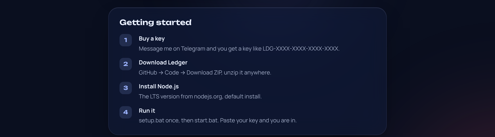

<p align="center"><a href="README.md">Русский</a> &nbsp;·&nbsp; <b>English</b></p>

<p align="center">
  
</p>

<p align="center">
  <a href="https://t.me/m4ks1em"></a>
  &nbsp;
  <a href="https://github.com/m4ks1em-maker/ledger/archive/refs/heads/main.zip"></a>
</p>

Ledger reads your Dota 2 replays and puts every report on a timeline, from teammates and from enemies. Paste a Steam ID and the replays download on their own, no Steam login.

<p align="center"></p>

Links from the steps: [Telegram @m4ks1em](https://t.me/m4ks1em) · [Download ZIP](https://github.com/m4ks1em-maker/ledger/archive/refs/heads/main.zip) · [Node.js](https://nodejs.org)

One key works on one computer. Replays are processed on your PC; only the key check goes online. Without internet Ledger keeps working for up to 3 days.

## What it looks like

| Sign in with a key | Home |
|---|---|
|  |  |
| **Match timeline** | **Stats** |
|  |  |

- Look a player up by Steam ID: recent matches, replays download from Valve's servers by themselves.
- Drop a `.dem` on the page if a replay is already gone from the servers.
- Incoming and outgoing reports, scoreboard activity, teammate vs enemy summary.
- Stats across every analysed match, CSV and JSON export.
- Auto-sync of new matches, dark and light theme, Russian and English.

<details>
<summary>How it works</summary>

```
browser ──► gate (localhost:8080) ──► engine server.exe (localhost:8081)
                │
                └──► key server (Cloudflare)
```

- `gate/` is the local Node.js app with no dependencies. It checks the key and starts and restarts the engine.
- `static/` is the interface.
- Keys are checked by a server on Cloudflare and stored there only as SHA-256.
- A key is bound to the computer and checked every 10 minutes. A revoked key signs you out at once; offline you get 3 days.
- Engine: [d3nd3/dota-report-timestamps](https://github.com/d3nd3/dota-report-timestamps) (MIT), downloaded by `setup.bat` into `engine/`.
</details>

## Licences

Third-party components and licences: [NOTICE.md](NOTICE.md). MIT licensed.
