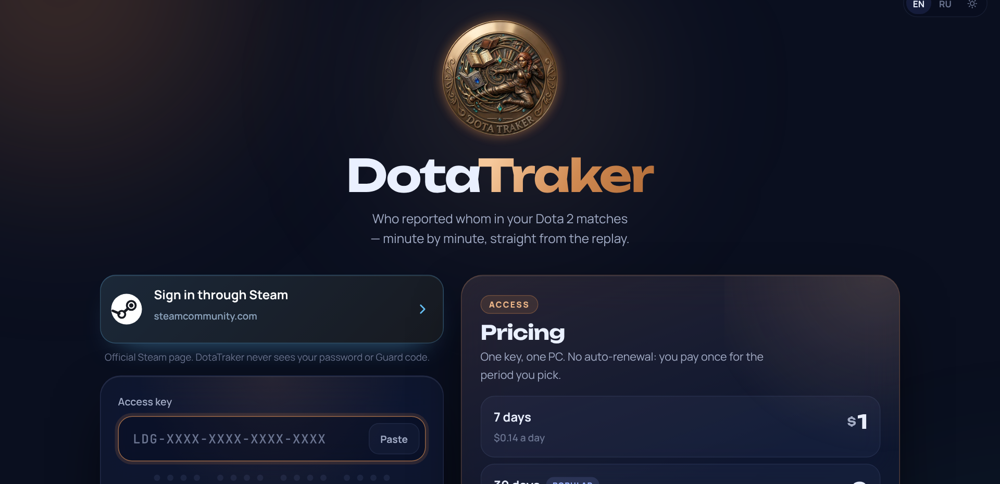
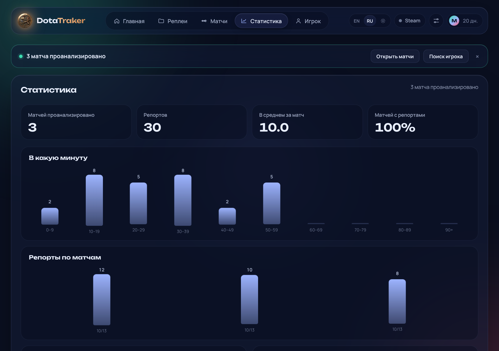

<a href="README.md">Русский</a> &nbsp;·&nbsp; <b>English</b>

  

  
  &nbsp;
  

DotaTraker reads your Dota 2 replays and puts every report on a timeline, from teammates and from enemies. Paste a Steam ID and the replays download on their own.

## Getting started

1. Install [Node.js](https://nodejs.org) (LTS).
2. [Download the ZIP](https://github.com/m4ks1em-maker/ledger---Dota-Report-FInder/archive/refs/heads/main.zip) and unpack it.
3. Run `setup.bat` once, then `start.bat`.
4. Sign in through Steam (the official steamcommunity.com page) and enter your key.

## Pricing

| Period | Price |
|---|---|
| 7 days | $1 |
| 30 days | $2 |
| 90 days | $5 |
| 1 year | $15 |
| **Forever** | **$30** |

Keys are sold on Telegram: [@m4ks1em](https://t.me/m4ks1em). One key works on one computer. Offline, DotaTraker keeps working for up to 3 days.

## Safe by design

- Sign-in goes through the **official Steam site** (OpenID). DotaTraker gets only your public Steam ID and never sees your password or Guard code.
- Replays are processed on your PC; only the key check goes online.
- The code is open, all of it is in this repository.

## Updates

When a new version is out, the app shows a "DotaTraker … is out" bar. The "Update now" button downloads it from GitHub and restarts the app. Your key, settings and replays stay where they are.

## What it looks like

| Sign in | Home |
|---|---|
|  |  |
| **Match timeline** | **Stats** |
|  |  |

- Look a player up by Steam ID: recent matches, replays download from Valve's servers by themselves.
- Drop a `.dem` on the page if a replay is already gone from the servers.
- Incoming and outgoing reports, scoreboard activity, teammate vs enemy summary.
- Stats across every analysed match, CSV and JSON export.
- Auto-sync of new matches, dark and light theme, Russian and English.
- Reads replays from the latest Dota patches (manta 1.5.1 parser).

## Author

**DotaTraker** is created and maintained by **Max** — [@m4ks1em](https://t.me/m4ks1em) · [GitHub](https://github.com/m4ks1em-maker).
Design, key server, Steam sign-in, updates and the engine build are his work.

MIT licensed. Third-party components and their licences: [NOTICE.md](NOTICE.md).
