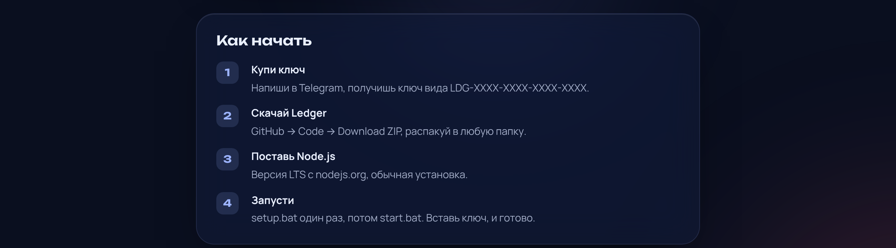
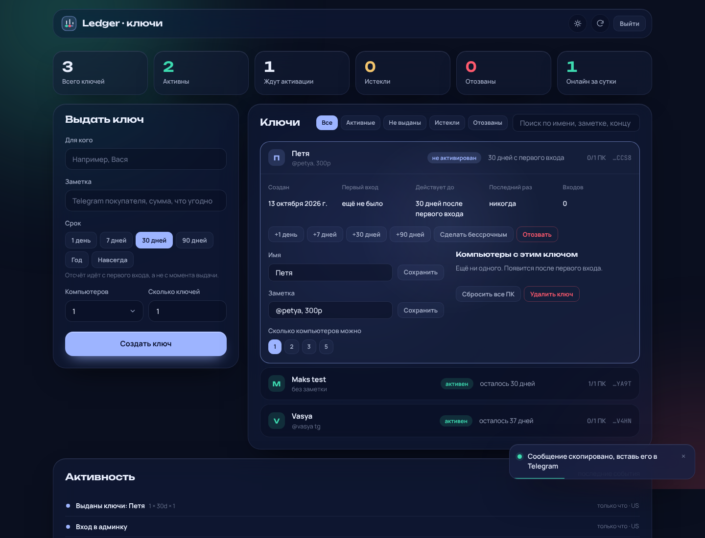

<p align="center">
  
</p>

<p align="center">
  <a href="https://t.me/m4ks1em"></a>
  &nbsp;
  <a href="https://github.com/m4ks1em-maker/ledger/archive/refs/heads/main.zip"></a>
</p>

Ledger разбирает реплеи Dota 2 и показывает каждый репорт на таймлайне: от союзников и от врагов. Вставь Steam ID, и реплеи скачаются сами, без входа в Steam.

<p align="center"></p>

Ссылки из шагов: [Telegram @m4ks1em](https://t.me/m4ks1em) · [Download ZIP](https://github.com/m4ks1em-maker/ledger/archive/refs/heads/main.zip) · [Node.js](https://nodejs.org)

Один ключ работает на одном компьютере. Реплеи разбираются у тебя на ПК, наружу уходит только проверка ключа. Без интернета Ledger работает до 3 дней.

## Как это выглядит

| Вход по ключу | Главная |
|---|---|
|  |  |
| **Таймлайн матча** | **Статистика** |
|  |  |

- Поиск игрока по Steam ID: последние матчи, реплеи качаются с серверов Valve сами.
- Перетащи `.dem` на страницу, если реплей уже удалён с серверов.
- Входящие и исходящие репорты, активность на табло, сводка по союзникам и врагам.
- Статистика по всем разобранным матчам, экспорт в CSV и JSON.
- Автосинк новых матчей, тёмная и светлая тема, русский и английский.

---

## Для владельца: сервер ключей

Ключи живут в базе на Cloudflare (бесплатный тариф, работает 24/7, твой ПК включать не нужно). Там же админка: выдать, продлить, отозвать ключ, отвязать компьютер.

<p align="center"></p>

**Первый запуск (один раз):**

1. Заведи бесплатный аккаунт на [cloudflare.com](https://dash.cloudflare.com/sign-up).
2. Открой `cloud\deploy.bat`. Он попросит войти в Cloudflare в браузере, создаст базу, выложит сервер и спросит пароль для админки.
3. В конце он запишет адрес сервера в `ledger.config.json`. Залей этот файл на GitHub, чтобы все новые загрузки знали, куда стучаться.
4. Админка: `https://ledger-keys.<твой-поддомен>.workers.dev/admin`.

**Продажа:** «Выдать ключ» → «Сообщение покупателю» копирует готовый текст с ключом и инструкцией, его остаётся вставить в Telegram.

Обновить сервер после правок: снова `cloud\deploy.bat`. Сменить пароль: `cloud\deploy.bat --password`. Контакт в Telegram меняется в `cloud/wrangler.toml` (`TELEGRAM`).

<details>
<summary>Как устроено</summary>

```
браузер ──► gate (localhost:8080) ──► движок server.exe (localhost:8081)
                │
                └──► сервер ключей на Cloudflare (Worker + D1)
```

- `gate/` — локальное приложение на Node.js без зависимостей. Проверяет ключ, сам запускает и перезапускает движок.
- `static/` — интерфейс.
- `cloud/` — сервер ключей: `/v1/activate`, `/v1/check`, админка `/admin`. Ключи хранятся только как SHA-256.
- Ключ привязан к компьютеру. Проверка раз в 10 минут; отозванный ключ выкидывает сразу, при оффлайне есть 3 дня запаса.
- Движок: [d3nd3/dota-report-timestamps](https://github.com/d3nd3/dota-report-timestamps) (MIT), скачивается `setup.bat` в папку `engine/`.

Настройки через переменные окружения: `GATE_PORT` (8080), `UPSTREAM`, `LICENSE_SERVER`, `OPENDOTA_KEY`, `LEDGER_NO_ENGINE=1`.
</details>

## English

Ledger shows who reported whom in your Dota 2 matches and the minute they did it. Buy a key from [@m4ks1em](https://t.me/m4ks1em) on Telegram, download the ZIP, install [Node.js](https://nodejs.org) LTS, run `setup.bat` once and then `start.bat`, and paste your key. One key works on one computer.

Credits and licences: see [NOTICE.md](NOTICE.md). MIT licensed.
