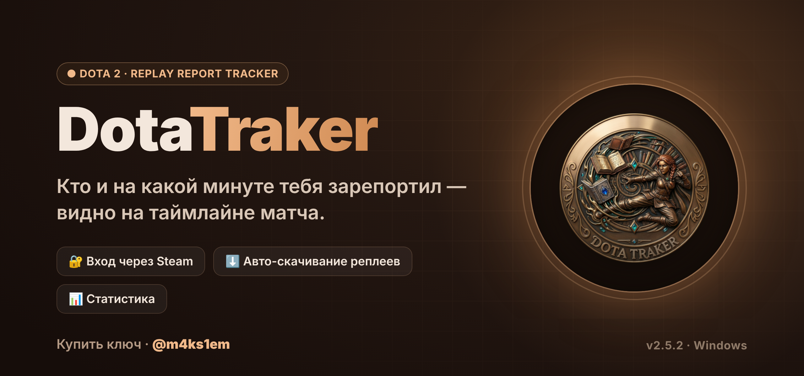
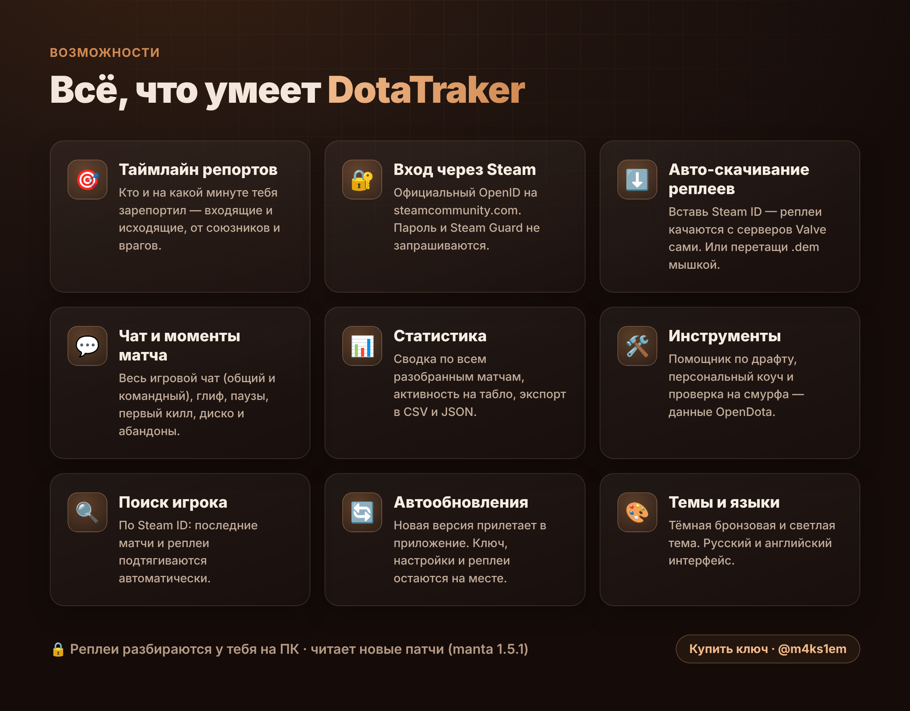

<b>Русский</b> &nbsp;·&nbsp; <a href="README.en.md">English</a>

  

  
  
  
  
  

  
  &nbsp;
  

<i>Поставь ⭐, если проект оказался полезным — это помогает другим его найти.</i>

---

## Демо

  

## Что умеет

  

## Как начать

1. Установи [Node.js](https://nodejs.org) (версия LTS).
2. [Скачай ZIP](https://github.com/m4ks1em-maker/ledger---Dota-Report-FInder/archive/refs/heads/main.zip) и распакуй.
3. Открой `setup.bat` (один раз), потом `start.bat`.
4. Войди через Steam (официальный сайт steamcommunity.com) и введи ключ.

> [!TIP]
> Без интернета DotaTraker продолжает работать до 3 дней — ключ проверяется периодически, а не каждый запуск.

## Цены

| Срок | Цена |
|---|---|
| 7 дней | $1 |
| 30 дней | $2 |
| 90 дней | $5 |
| 1 год | $15 |
| **Навсегда** | **$30** |

Ключ покупается в Telegram: **[@m4ks1em](https://t.me/m4ks1em)**. Один ключ работает на одном компьютере.

## Безопасно

- Вход через **официальный сайт Steam** (OpenID). DotaTraker получает только публичный Steam ID — пароль и код Guard он не видит.
- Реплеи разбираются **у тебя на ПК**, наружу уходит только проверка ключа.
- Читает реплеи **с новых патчей** Dota (парсер manta 1.5.1).

## Как это выглядит

| Вход | Главная |
|---|---|
|  |  |
| **Таймлайн матча** | **Статистика** |
|  |  |

## Обновления

Когда выходит новая версия, в приложении появляется плашка «Вышел DotaTraker …». Кнопка «Обновить» скачивает её с GitHub и перезапускает программу. Ключ, настройки и реплеи остаются на месте.

## FAQ

<b>Это бан-рисковый софт? Меня забанят?</b>
 
Нет. DotaTraker не трогает игру и не лезет в клиент Dota. Он читает уже сыгранные реплеи (<code>.dem</code>) — те же файлы, что доступны всем через серверы Valve.

<b>Нужно вводить пароль от Steam?</b>
 
Нет. Вход идёт через официальный OpenID Steam на steamcommunity.com. Программа видит только твой публичный Steam ID.

<b>Работает на macOS / Linux?</b>
 
Сейчас сборка под Windows. Движок кросс-платформенный (Go), так что порт возможен — напиши в Telegram, если нужно.

<b>Реплей уже удалён с серверов Valve. Что делать?</b>
 
Перетащи файл <code>.dem</code> прямо на страницу — DotaTraker разберёт его локально.

## Автор

**DotaTraker** создал и развивает **Макс** — [@m4ks1em](https://t.me/m4ks1em) · [GitHub](https://github.com/m4ks1em-maker).
Дизайн, сервер ключей, вход через Steam, обновления и сборка движка — его работа.

Лицензия MIT. Сторонние компоненты и их лицензии: <a href="NOTICE.md">NOTICE.md</a>.
