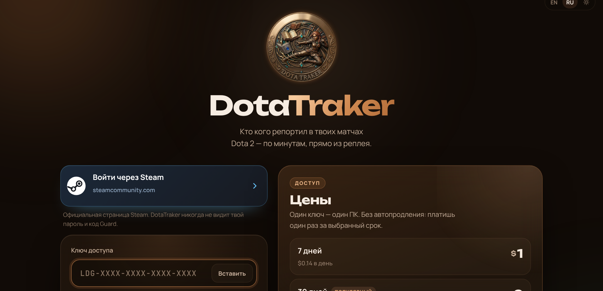

<b>Русский</b> &nbsp;·&nbsp; <a href="README.en.md">English</a>

  

  
  &nbsp;
  

DotaTraker разбирает реплеи Dota 2 и показывает каждый репорт на таймлайне: от союзников и от врагов. Вставь Steam ID, и реплеи скачаются сами.

## Как начать

1. Установи [Node.js](https://nodejs.org) (версия LTS).
2. [Скачай ZIP](https://github.com/m4ks1em-maker/ledger/archive/refs/heads/main.zip) и распакуй.
3. Открой `setup.bat` (один раз), потом `start.bat`.
4. Войди через Steam (официальный сайт steamcommunity.com) и введи ключ.

## Цены

| Срок | Цена |
|---|---|
| 7 дней | $1 |
| 30 дней | $2 |
| 90 дней | $5 |
| 1 год | $15 |
| **Навсегда** | **$30** |

Ключ покупается в Telegram: [@m4ks1em](https://t.me/m4ks1em). Один ключ работает на одном компьютере. Без интернета DotaTraker работает до 3 дней.

## Безопасно

- Вход через **официальный сайт Steam** (OpenID). DotaTraker получает только публичный Steam ID, пароль и код Guard он не видит.
- Реплеи разбираются у тебя на ПК, наружу уходит только проверка ключа.
- Код открыт, он весь в этом репозитории.

## Обновления

Когда выходит новая версия, в приложении появляется плашка «Вышел DotaTraker …». Кнопка «Обновить» скачивает новую версию с GitHub и перезапускает программу. Ключ, настройки и реплеи остаются на месте.

## Как это выглядит

| Вход | Главная |
|---|---|
|  |  |
| **Таймлайн матча** | **Статистика** |
|  |  |

- Поиск игрока по Steam ID: последние матчи, реплеи качаются с серверов Valve сами.
- Перетащи `.dem` на страницу, если реплей уже удалён с серверов.
- Входящие и исходящие репорты, активность на табло, сводка по союзникам и врагам.
- Статистика по всем разобранным матчам, экспорт в CSV и JSON.
- Автосинк новых матчей, тёмная и светлая тема, русский и английский.
- Читает реплеи с новых патчей Dota (парсер manta 1.5.1).

## Автор

**DotaTraker** создал и развивает **Макс** — [@m4ks1em](https://t.me/m4ks1em) · [GitHub](https://github.com/m4ks1em-maker).
Дизайн, сервер ключей, вход через Steam, обновления и сборка движка — его работа.

Лицензия MIT. Сторонние компоненты и их лицензии: [NOTICE.md](NOTICE.md).
