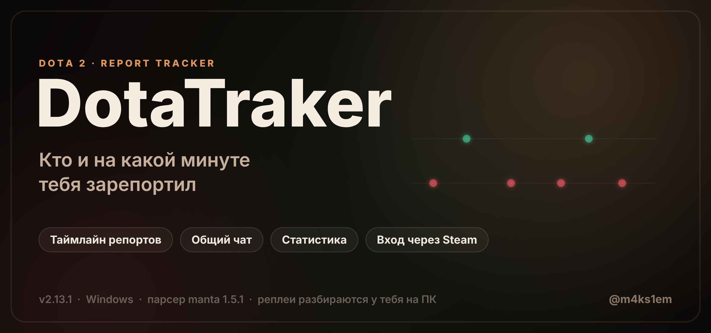
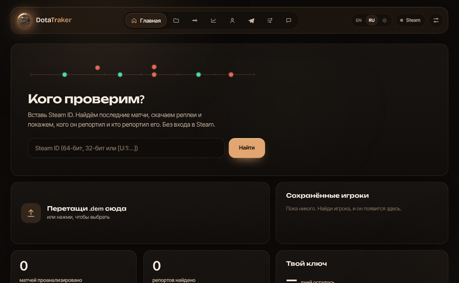
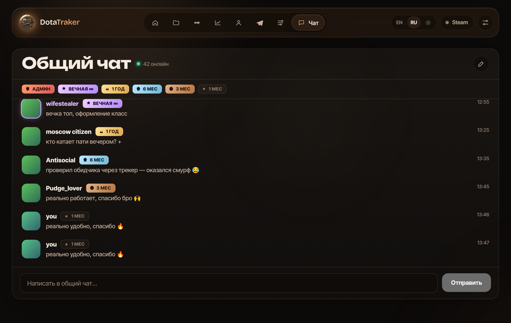
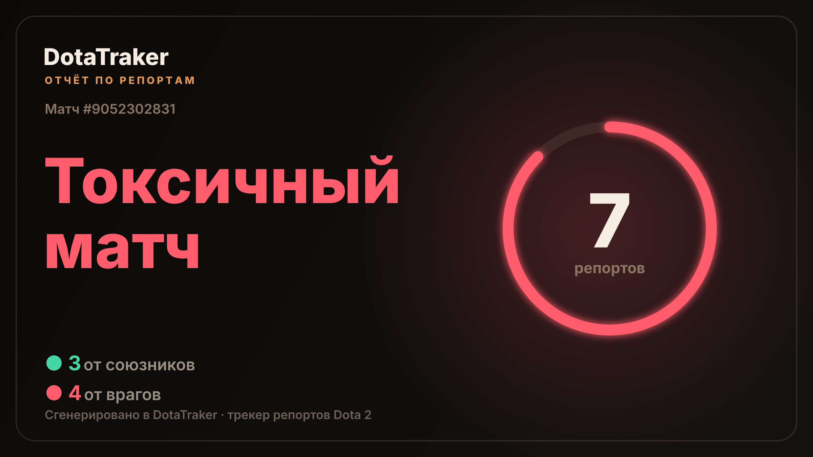
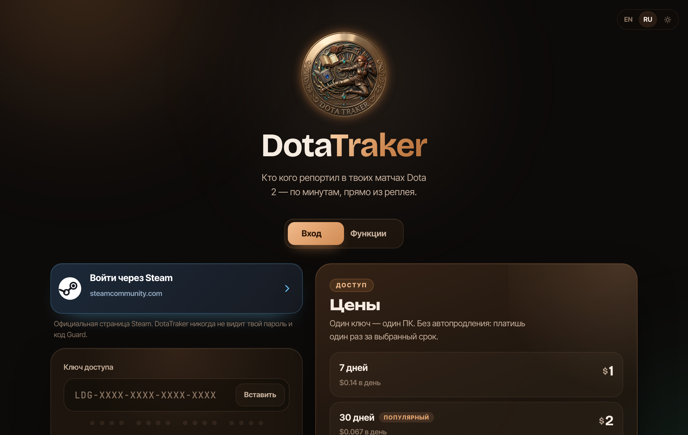
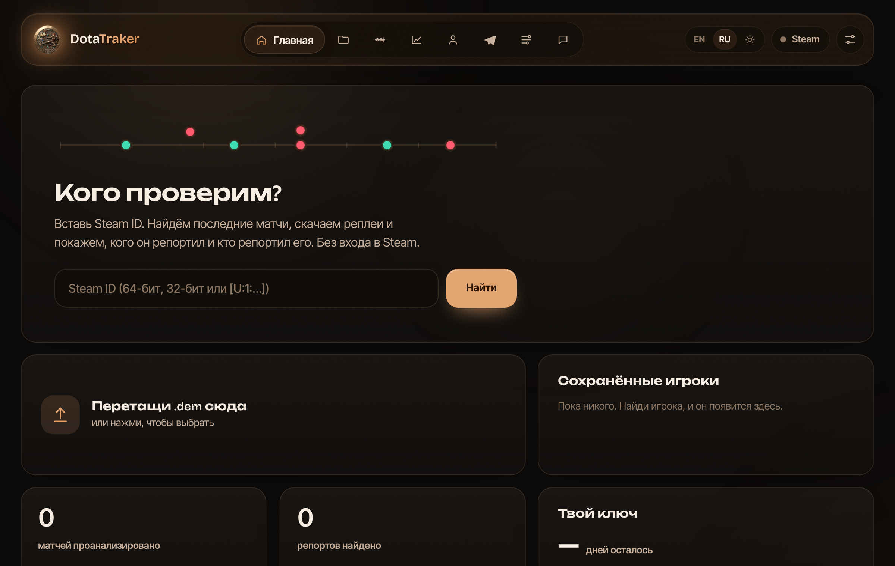
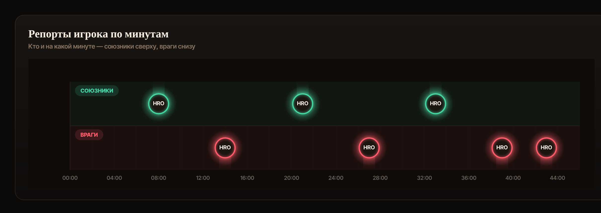

<b>Русский</b> &nbsp;·&nbsp; <a href="README.en.md">English</a>

  

  
  
  
  
  
  

  
  &nbsp;
  

<i>Поставь ⭐, если проект оказался полезным — это помогает другим его найти.</i>

---

<h3 align="center">Твой личный детектив репортов в Dota 2</h3>

  Загрузи реплей — и увидь <b>кто</b>, <b>когда</b> и <b>на какой минуте</b> тебя зарепортил. Всё разбирается у тебя на ПК, без консоли и без риска для аккаунта.

<table align="center">
<tr>
<td align="center" width="25%">🎯 <b>Таймлайн репортов</b> кто кого и на какой минуте</td>
<td align="center" width="25%">💬 <b>Общий чат</b> со всеми игроками + бейджи</td>
<td align="center" width="25%">📊 <b>Статистика</b> по всем матчам сразу</td>
<td align="center" width="25%">📤 <b>Шеринг матча</b> красивая картинка-отчёт</td>
</tr>
</table>

---

## 🎬 Демо

  

## ✨ Что нового в 2.13

- 💬 **Общий чат** — живое общение со всеми игроками DotaTraker, история сообщений, @упоминания, разделители по дням, онлайн-счётчик.
- 🏅 **Бейджи по подписке** — 1 мес → вечная ∞, статус **Админ**, аватары из Steam.
- 🛡️ **Модерация** — мут и бан прямо из чата (для админов).
- 📤 **Шеринг-карточка матча** — одна кнопка → премиум-картинка «кто кого репортил» для шеринга.

## 💬 Общий чат

  

Вход по Steam → твой ник и аватар. Значок рядом с ником зависит от срока подписки. Админ может банить и мутить.

## 📤 Поделись матчем

  

Кнопка «Поделиться» на экране матча собирает вот такую картинку — закинь в чат пати или в Telegram.

## ⚡ Что умеет

<table>
<tr><td width="50%" valign="top">

**Репорты**
- Кто и на какой минуте тебя зарепортил
- Входящие и исходящие репорты
- Вердикт матча: от «спокойный» до «токсичный»
- Таймлайн по минутам с иконками героев

</td><td width="50%" valign="top">

**Больше**
- Общий чат с бейджами и модерацией
- Статистика по всем загруженным матчам
- Экспорт в CSV / JSON
- Открытие матча на OpenDota и Dotabuff

</td></tr>
</table>

## 🚀 Как начать

1. Установи [Node.js](https://nodejs.org) (версия LTS).
2. [Скачай ZIP](https://github.com/m4ks1em-maker/ledger---Dota-Report-FInder/archive/refs/heads/main.zip) и распакуй.
3. Открой `setup.bat` (один раз), потом `start.bat`.
4. Войди через Steam (официальный сайт steamcommunity.com) и введи ключ.

> [!TIP]
> Без интернета DotaTraker продолжает работать до 3 дней — ключ проверяется периодически, а не каждый запуск.

## 💳 Цены

<table>
<tr><th>Срок</th><th>Цена</th></tr>
<tr><td>7 дней</td><td>$1</td></tr>
<tr><td>30 дней</td><td>$2</td></tr>
<tr><td>90 дней</td><td>$5</td></tr>
<tr><td>1 год</td><td>$15</td></tr>
<tr><td><b>Навсегда</b></td><td><b>$30</b></td></tr>
</table>

Ключ покупается в Telegram: **[@m4ks1em](https://t.me/m4ks1em)**. Один ключ работает на одном компьютере.

## 🔒 Безопасно

- Вход через **официальный сайт Steam** (OpenID). DotaTraker получает только публичный Steam ID — пароль и код Guard он не видит.
- Реплеи разбираются **у тебя на ПК**, наружу уходит только проверка ключа.
- Читает реплеи **с новых патчей** Dota (парсер manta 1.5.1).

## 📸 Как это выглядит

| Вход | Главная |
|---|---|
|  |  |
| **Общий чат** | **Таймлайн матча** |
|  |  |

## 🔄 Обновления

Когда выходит новая версия, в приложении появляется плашка «Вышел DotaTraker …». Кнопка «Обновить» скачивает её с GitHub и перезапускает программу. Ключ, настройки и реплеи остаются на месте.

## ❓ FAQ

<b>Это бан-рисковый софт? Меня забанят?</b>
 
Нет. DotaTraker не трогает игру и не лезет в клиент Dota. Он читает уже сыгранные реплеи (<code>.dem</code>) — те же файлы, что доступны всем через серверы Valve.

<b>Нужно вводить пароль от Steam?</b>
 
Нет. Вход идёт через официальный OpenID Steam на steamcommunity.com. Программа видит только твой публичный Steam ID.

<b>Что за общий чат? Там видно мой аккаунт?</b>
 
Это чат для всех игроков DotaTraker. Виден твой Steam-ник и аватар, рядом — значок по сроку подписки. Пароль и личные данные не раскрываются.

<b>Работает на macOS / Linux?</b>
 
Сейчас сборка под Windows. Движок кросс-платформенный (Go), так что порт возможен — напиши в Telegram, если нужно.

<b>Реплей уже удалён с серверов Valve. Что делать?</b>
 
Перетащи файл <code>.dem</code> прямо на страницу — DotaTraker разберёт его локально.

## 👤 Автор

**DotaTraker** создал и развивает **Макс** — [@m4ks1em](https://t.me/m4ks1em) · [GitHub](https://github.com/m4ks1em-maker).
Дизайн, сервер ключей, вход через Steam, общий чат, обновления и сборка движка — его работа.

Лицензия MIT. Сторонние компоненты и их лицензии: <a href="NOTICE.md">NOTICE.md</a>.
